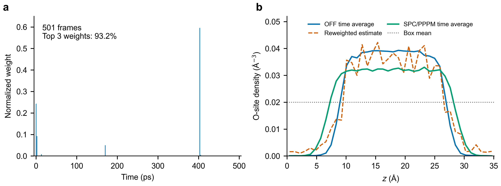

# OFF → POLAR：重加权因子方差与直接关联函数

> **本周归档与 MD 热波动口径：** [六分子完整报告、可编辑流程和采样预算](docs/reports/WEEKLY_CDFT_THERMAL_20261028/README.md)。在 300 K 的 384 水分子 OFF23 轨迹上，同帧比较（去掉前 20 ps，481 帧）：OFF23 势能标准差 **1.388 meV/atom**，POLAR−OFF23 势能差标准差 **0.297 meV/atom**，后者为前者的 **0.214 倍**。全部 501 帧对应 1.562、0.309 meV/atom，比值 0.198。20 ps 是敏感性切点，不代表已证明平衡；数值是整盒能量标准差除以 1152 原子。这个比较用于初筛，目标密度及关联仍需验证。

## 当前 reweighting factor 的方差有多大？

**对上传的501帧能量表，重加权因子的经验相对方差是 `212.311856`，相对标准差约 `14.6`（1460%）；Kish ESS为 `2.348674 / 501 = 0.4688%`。** 最大单帧占总权重的59.60%，前三帧合计93.22%。

数据条件：**MACE-OFF23 → MACE-POLAR；300 K；384个水分子 / 1152个原子；500 ps、每1 ps一帧，共501帧。** 以下方差均使用分母 n = 501，不是 n − 1。

### 权重定义与数值

令 ΔU[i] = U_POLAR[i] − U_OFF23[i]，q[i] = exp(−ΔU[i]/(kB × T))，q_mean 为所有 q 的平均值，T 是温度。原始指数因子随能量零点缩放，因此比较时应看**相对方差**：

```text
CV² = mean((q − q_mean)²) / q_mean² = 212.311856
```

| 量 | 明确定义 | 当前结果 |
|---|---|---:|
| **重加权因子的相对方差** | `CV² = v_q / q_mean²` | **212.311856** |
| 均值为1的权重方差 | `R[i] = q[i] / q_mean = n × w[i]`；`v_R = mean((R − 1)²)` | 212.311856 |
| 归一化权重方差 | `w[i] = q[i] / sum(q)`；`v_w = mean((w − 1/n)²)` | 0.000845860599 |
| 指定能量参考后的指数因子方差 | `a[i] = exp(−(ΔU[i] − min(ΔU))/(kB × T))`；`v_a = mean((a − mean(a))²)` | 0.002381360301 |
| **Kish ESS** | `ESS = 1 / sum(w²) = n / (1 + CV²)` | **2.348674（0.4688%）** |
| 最大单帧权重 | `max(w)` | 59.5987% |
| 前三帧合计权重 | 最大的三个 w[i] 之和 | 93.2183% |
| 整盒能量差标准差 | sd(ΔU)，其中 ΔU = U_POLAR − U_OFF23 | 0.355765 eV（13.7616 kBT） |

**不要把 `0.00084586` 解释成“波动很小”：** 这是总和为1的权重 w[i] 的方差，被 n² 缩小了。均值为1的权重满足 `v_R = n² × v_w = 212.31`。统一减去能量常数不改变相对方差或ESS。

### 以整体波动不超过2倍为准：场强和温度范围

以300 K、无外场OFF→POLAR的 `std(ln q₁)=13.224` 为1倍，下表给出叠加场和变温后整体波动不超过2倍的**单轨迹样本比较范围**。外场是沿z的正向均匀电场，使用1.85 D固定偶极代理，单位 **V/Å**；并非0.25 V的电势差，也不含POLAR自洽极化。温度是对一条300 K OFF23轨迹作后处理，没有新跑各温度的POLAR或OFF轨迹。

| 目标温度 | ΔT（相对300 K） | E=0.25 V/Å时整体比值 | 该温度下达到2倍的正向E（V/Å） |
|---:|---:|---:|---:|
| 200 K | −100 K | 3.262 | 无正向2倍交点，零场已超过2倍 |
| 250 K | −50 K | 2.227 | 0.210 |
| **260 K** | **−40 K** | **2.106** | **0.231** |
| 270 K | −30 K | 2.009 | 0.248 |
| 280 K | −20 K | 1.933 | 0.262 |
| 290 K | −10 K | 1.876 | 0.273 |
| 300 K | 0 K | 1.837 | 0.282 |
| 310 K | +10 K | 1.812 | 0.288 |
| 320 K | +20 K | 1.800 | 0.293 |
| 330 K | +30 K | 1.798 | 0.295 |
| 350 K | +50 K | 1.822 | 0.295 |
| 375 K | +75 K | 1.884 | 0.284 |
| 400 K | +100 K | 1.967 | 0.262 |

**260 K可以作为后续采样候选。** 在 E=0.25 V/Å 时整体波动为 **2.106倍**，略高于暂定的2倍比较线；若坚持不超过2倍，260 K的正向均匀场应约为 **0.231 V/Å或更低**。2倍是人为选择的比较线，不代表超过后一定不可用。

**E=0.25 V/Å时，以2倍波动为比较线，在该样本的固定偶极模型中温度约为271–409 K（相对300 K约−29到+109 K）；不能写成±100 K。** 200 K时叠加后是3.262倍，而400 K约1.967倍。该数学范围不是已验证的适用或准确范围，特别是权重覆盖、有限时间以及源能量精度均未解决；不同方向/场形或自洽POLAR电场可能给出不同结果。[范围数据与公式](docs/results/reweight_boundary_scan_20261028/range_2x_20261028/range.json)。

### 六分子采样与泛化：本周归档

[完整PDF报告、可编辑流程图、六分子预算和证据入口](docs/reports/WEEKLY_CDFT_THERMAL_20261028/README.md)。按“温度和外场先复用基础轨迹”的条件方案：最低探索6条源轨迹；建议每种1个基础状态、2个副本共**12条源轨迹**，另建议6条POLAR短对照；若每种需要3个体相密度锚点则扩展至**36条源轨迹**。现有水轨迹为分层诊断、不可预先当成合格体相1 ns。各分子的实际可复用范围需用目标统计误差和独立参考验收。

### q₁(V, β(T))：外势和温度叠加后的整体波动

**只用一条轨迹：** OFF23在300 K的500 ps生产轨迹；前20帧表现出明显变化，暂时剔除，保留481帧。每帧已有OFF23和POLAR的单点能量，**没有运行POLAR目标轨迹**。10个随机场种子只是同一轨迹上的10种外场，不是10条独立MD。

**比较方式：先把OFF–POLAR势差、外势和温度项在每帧合起来，再统计整体幅度。**以无额外外势、T=300 K时OFF–POLAR的指数波动 **13.224** 作为1倍。每个格子只写 `整体波动幅度 / 相对原始OFF–POLAR的幅度比值`：大于1表示比原来大，小于1表示更小，等于1表示相同；**比值达到2表示整体波动为原来的2倍**，表中以粗体标出。

```text
ΔU = U_POLAR − U_OFF23
β300 = 1 / (kB × 300 K)；βT = 1 / (kB × T)
ln q₁(V,T) = β300 × U_OFF23 − βT × (U_POLAR + U_ext) + 常数
整体波动幅度 = std[ln q₁(V,T)]
幅度比值 = 整体波动幅度 / 13.224
```

这里U为每帧整盒能量，U_ext是整盒外势能；计算时移除与构型无关的常数。此q₁同时包含 **OFF–POLAR势差、目标外势和从300 K到T的温度变化**。势差、外势和温度项存在相关性，所以整体标准差不能直接按“1倍+1倍”相加；变温时势差项也会随βT变化。这里的波动是 `std(ln q₁)`，不是会受能量零点影响的原始 `std(q₁)`。

**场和温度的含义：**随机原子场s为无量纲幅度，每格为10种随机场形的整体标准差平均值；均匀电场采用1.85 D固定水分子偶极代理，已处理周期边界，但不含POLAR自洽极化。外势仅加在目标侧；同温时若源和目标加相同场，这部分在势能差中抵消。270–400 K只是将同一条300 K源轨迹代入不同β作后处理，**不是这些温度下独立运行的轨迹**。

| 扰动方式 | 参数 | 270 K | 280 K | 290 K | 295 K | 300 K | 305 K | 310 K | 320 K | 330 K | 340 K | 350 K | 360 K | 380 K | 400 K |
|---|---:|---:|---:|---:|---:|---:|---:|---:|---:|---:|---:|---:|---:|---:|---:|
| 无外场 | 0 | 14.35 / 1.085 | 13.59 / 1.028 | 13.23 / 1.001 | 13.19 / 0.997 | 13.22 / 1.000 | 13.33 / 1.008 | 13.50 / 1.021 | 13.99 / 1.058 | 14.64 / 1.107 | 15.40 / 1.165 | 16.23 / 1.227 | 17.09 / 1.292 | 18.85 / 1.426 | 20.60 / 1.557 |
| 随机原子场 s | 0.01 | 14.34 / 1.084 | 13.59 / 1.027 | 13.23 / 1.000 | 13.18 / 0.997 | 13.22 / 1.000 | 13.33 / 1.008 | 13.49 / 1.020 | 13.99 / 1.058 | 14.64 / 1.107 | 15.40 / 1.164 | 16.22 / 1.227 | 17.09 / 1.292 | 18.85 / 1.426 | 20.60 / 1.557 |
| 随机原子场 s | 0.02 | 14.34 / 1.085 | 13.59 / 1.028 | 13.23 / 1.001 | 13.19 / 0.997 | 13.22 / 1.000 | 13.33 / 1.008 | 13.50 / 1.021 | 13.99 / 1.058 | 14.64 / 1.107 | 15.40 / 1.165 | 16.23 / 1.227 | 17.09 / 1.292 | 18.86 / 1.426 | 20.60 / 1.558 |
| 随机原子场 s | 0.05 | 14.40 / 1.089 | 13.65 / 1.032 | 13.29 / 1.005 | 13.24 / 1.002 | 13.28 / 1.004 | 13.38 / 1.012 | 13.55 / 1.025 | 14.04 / 1.062 | 14.69 / 1.111 | 15.44 / 1.168 | 16.26 / 1.230 | 17.12 / 1.295 | 18.88 / 1.428 | 20.62 / 1.559 |
| 随机原子场 s | 0.1 | 14.68 / 1.110 | 13.93 / 1.053 | 13.56 / 1.025 | 13.50 / 1.021 | 13.53 / 1.023 | 13.63 / 1.030 | 13.78 / 1.042 | 14.25 / 1.078 | 14.88 / 1.125 | 15.62 / 1.181 | 16.42 / 1.242 | 17.27 / 1.306 | 19.00 / 1.437 | 20.72 / 1.567 |
| 随机原子场 s | 0.2 | 15.85 / 1.199 | 15.07 / 1.140 | 14.66 / 1.109 | 14.58 / 1.102 | 14.57 / 1.102 | 14.63 / 1.106 | 14.75 / 1.115 | 15.13 / 1.144 | 15.68 / 1.186 | 16.34 / 1.236 | 17.07 / 1.291 | 17.86 / 1.350 | 19.49 / 1.474 | 21.13 / 1.598 |
| 随机原子场 s | 0.3 | 17.67 / 1.336 | 16.84 / 1.274 | 16.36 / 1.237 | 16.23 / 1.228 | 16.18 / 1.223 | 16.18 / 1.224 | 16.24 / 1.228 | 16.51 / 1.249 | 16.94 / 1.281 | 17.49 / 1.323 | 18.13 / 1.371 | 18.81 / 1.423 | 20.29 / 1.534 | 21.80 / 1.649 |
| 随机原子场 s | 0.4 | 19.93 / 1.507 | 19.04 / 1.440 | 18.48 / 1.397 | 18.30 / 1.384 | 18.18 / 1.375 | 18.13 / 1.371 | 18.13 / 1.371 | 18.27 / 1.381 | 18.57 / 1.404 | 18.99 / 1.436 | 19.50 / 1.474 | 20.08 / 1.518 | 21.35 / 1.615 | 22.71 / 1.717 |
| 随机原子场 s | 0.5 | 22.49 / 1.701 | 21.54 / 1.629 | 20.87 / 1.579 | 20.64 / 1.561 | 20.47 / 1.548 | 20.35 / 1.539 | 20.29 / 1.534 | 20.29 / 1.535 | 20.46 / 1.547 | 20.74 / 1.568 | 21.12 / 1.597 | 21.58 / 1.632 | 22.64 / 1.712 | 23.82 / 1.801 |
| 随机原子场 s | 0.6 | 25.27 / 1.911 | 24.24 / 1.833 | 23.47 / 1.775 | 23.18 / 1.753 | 22.95 / 1.735 | 22.77 / 1.722 | 22.64 / 1.712 | 22.52 / 1.703 | 22.54 / 1.705 | 22.69 / 1.716 | 22.95 / 1.735 | 23.28 / 1.760 | 24.12 / 1.824 | 25.10 / 1.898 |
| 随机原子场 s | 0.7326 | **29.19 / 2.207** | **28.03 / 2.119** | **27.12 / 2.051** | **26.76 / 2.023** | **26.45 / 2.000** | 26.19 / 1.980 | 25.98 / 1.964 | 25.68 / 1.942 | 25.53 / 1.931 | 25.51 / 1.929 | 25.59 / 1.935 | 25.76 / 1.948 | 26.30 / 1.989 | **27.02 / 2.043** |
| 随机原子场 s | 0.8 | **31.25 / 2.363** | **30.02 / 2.270** | **29.05 / 2.196** | **28.64 / 2.166** | **28.29 / 2.139** | **27.99 / 2.117** | **27.74 / 2.097** | **27.35 / 2.069** | **27.12 / 2.051** | **27.02 / 2.043** | **27.02 / 2.043** | **27.11 / 2.050** | **27.49 / 2.079** | **28.07 / 2.123** |
| 随机原子场 s | 1 | **37.56 / 2.840** | **36.13 / 2.732** | **34.93 / 2.641** | **34.41 / 2.602** | **33.95 / 2.567** | **33.53 / 2.535** | **33.15 / 2.507** | **32.53 / 2.460** | **32.05 / 2.424** | **31.70 / 2.397** | **31.47 / 2.380** | **31.33 / 2.369** | **31.28 / 2.365** | **31.46 / 2.379** |
| 均匀电场 V/Å | 0.001 | 14.35 / 1.085 | 13.60 / 1.028 | 13.24 / 1.001 | 13.19 / 0.998 | 13.23 / 1.000 | 13.33 / 1.008 | 13.50 / 1.021 | 14.00 / 1.058 | 14.65 / 1.108 | 15.40 / 1.165 | 16.23 / 1.227 | 17.09 / 1.292 | 18.86 / 1.426 | 20.60 / 1.558 |
| 均匀电场 V/Å | 0.005 | 14.36 / 1.086 | 13.61 / 1.029 | 13.25 / 1.002 | 13.21 / 0.999 | 13.24 / 1.001 | 13.35 / 1.009 | 13.52 / 1.022 | 14.01 / 1.060 | 14.66 / 1.109 | 15.42 / 1.166 | 16.24 / 1.228 | 17.11 / 1.294 | 18.87 / 1.427 | 20.61 / 1.559 |
| 均匀电场 V/Å | 0.01 | 14.38 / 1.088 | 13.63 / 1.031 | 13.28 / 1.004 | 13.23 / 1.001 | 13.27 / 1.003 | 13.38 / 1.012 | 13.55 / 1.024 | 14.04 / 1.062 | 14.69 / 1.111 | 15.45 / 1.168 | 16.27 / 1.230 | 17.13 / 1.295 | 18.89 / 1.429 | 20.63 / 1.560 |
| 均匀电场 V/Å | 0.02 | 14.47 / 1.094 | 13.73 / 1.038 | 13.37 / 1.011 | 13.33 / 1.008 | 13.36 / 1.011 | 13.47 / 1.019 | 13.64 / 1.031 | 14.13 / 1.068 | 14.77 / 1.117 | 15.52 / 1.174 | 16.34 / 1.236 | 17.20 / 1.300 | 18.95 / 1.433 | 20.68 / 1.564 |
| 均匀电场 V/Å | 0.05 | 15.06 / 1.139 | 14.32 / 1.083 | 13.95 / 1.055 | 13.90 / 1.051 | 13.92 / 1.053 | 14.01 / 1.060 | 14.16 / 1.071 | 14.61 / 1.105 | 15.22 / 1.151 | 15.94 / 1.205 | 16.72 / 1.264 | 17.55 / 1.327 | 19.25 / 1.456 | 20.94 / 1.584 |
| 均匀电场 V/Å | 0.1 | 16.95 / 1.282 | 16.18 / 1.224 | 15.76 / 1.192 | 15.67 / 1.185 | 15.64 / 1.183 | 15.68 / 1.186 | 15.78 / 1.193 | 16.11 / 1.218 | 16.60 / 1.255 | 17.20 / 1.300 | 17.87 / 1.352 | 18.60 / 1.407 | 20.14 / 1.523 | 21.70 / 1.641 |
| 均匀电场 V/Å | 0.15 | 19.68 / 1.488 | 18.86 / 1.426 | 18.35 / 1.387 | 18.19 / 1.376 | 18.10 / 1.369 | 18.07 / 1.366 | 18.09 / 1.368 | 18.27 / 1.381 | 18.59 / 1.406 | 19.04 / 1.440 | 19.57 / 1.480 | 20.16 / 1.525 | 21.46 / 1.623 | 22.83 / 1.727 |
| 均匀电场 V/Å | 0.2 | 22.95 / 1.736 | 22.05 / 1.667 | 21.42 / 1.620 | 21.20 / 1.603 | 21.04 / 1.591 | 20.93 / 1.583 | 20.87 / 1.578 | 20.88 / 1.579 | 21.03 / 1.591 | 21.31 / 1.611 | 21.68 / 1.639 | 22.12 / 1.672 | 23.15 / 1.750 | 24.29 / 1.837 |
| 均匀电场 V/Å | 0.25 | **26.57 / 2.009** | 25.56 / 1.933 | 24.81 / 1.876 | 24.52 / 1.854 | 24.29 / 1.837 | 24.10 / 1.822 | 23.96 / 1.812 | 23.80 / 1.800 | 23.78 / 1.798 | 23.89 / 1.806 | 24.09 / 1.822 | 24.37 / 1.843 | 25.11 / 1.899 | 26.01 / 1.967 |
| 均匀电场 V/Å | 0.2817 | **28.98 / 2.191** | **27.90 / 2.110** | **27.07 / 2.047** | **26.73 / 2.021** | **26.45 / 2.000** | 26.21 / 1.982 | 26.02 / 1.968 | 25.76 / 1.948 | 25.64 / 1.939 | 25.64 / 1.939 | 25.74 / 1.946 | 25.92 / 1.960 | **26.48 / 2.002** | **27.21 / 2.058** |
| 均匀电场 V/Å | 0.3 | **30.41 / 2.299** | **29.28 / 2.214** | **28.40 / 2.148** | **28.04 / 2.120** | **27.73 / 2.097** | **27.47 / 2.077** | **27.25 / 2.060** | **26.92 / 2.036** | **26.74 / 2.022** | **26.69 / 2.018** | **26.73 / 2.021** | **26.85 / 2.031** | **27.31 / 2.065** | **27.94 / 2.113** |
| 均匀电场 V/Å | 0.4 | **38.48 / 2.910** | **37.09 / 2.805** | **35.94 / 2.717** | **35.43 / 2.679** | **34.97 / 2.645** | **34.56 / 2.614** | **34.19 / 2.585** | **33.56 / 2.538** | **33.08 / 2.501** | **32.71 / 2.473** | **32.45 / 2.454** | **32.28 / 2.441** | **32.18 / 2.433** | **32.31 / 2.443** |
| 均匀电场 V/Å | 0.5 | **46.85 / 3.542** | **45.18 / 3.417** | **43.74 / 3.308** | **43.09 / 3.259** | **42.49 / 3.213** | **41.94 / 3.171** | **41.42 / 3.132** | **40.51 / 3.063** | **39.73 / 3.005** | **39.08 / 2.955** | **38.55 / 2.915** | **38.11 / 2.882** | **37.48 / 2.835** | **37.13 / 2.808** |

**300 K附近的2倍位置：**无外场的原始OFF–POLAR为 `13.224 / 1.000`；只增加外势、T=300 K时，随机原子场约 **s=0.733**（10种场形的平均幅度口径），固定偶极电场约 **0.282 V/Å**，整体波动均约为2倍。随机场10个种子的单独2倍位置约为0.519–1.369；平均值不代表每一种场形都在该处达到2倍。表中温度范围限定为270–400 K，重点查看300 K附近，未另行在高温跑MD。

[下载完整组合扫描CSV](docs/results/reweight_boundary_scan_20261028/q1_practical_final_20261028.csv) · [单独大表](docs/results/reweight_boundary_scan_20261028/q1_practical_final_20261028.md) · [2倍交点数据](docs/results/reweight_boundary_scan_20261028/q1_final_crossings_20261028.json) · [原轨迹、前段截断及场形](docs/results/reweight_boundary_scan_20261028/README.md)。2倍只是本样本下约定的比较线，不代表体系平衡或目标预测准确；表格保留三位小数，接近1或2的结果可能被四舍五入。

### 关键诊断图



**图 B 新增绿色实线：经典 SPC 三点参数 + PPPM 的时间平均。** 三条密度曲线都采用氧位点、同一周期盒、300 K、384 个水和 40 个 z 分箱；使用各自全部 501 个生产帧（0–500 ps），未平滑、未按层中心平移。SPC 与 OFF23 都出现分层；SPC 是不同势函数的参考，不能视为 POLAR 真值。重加权虚线仍为同一 OFF23 帧上的目标估计。这些 O 位点密度不能直接充当质心密度或已认证的均相 c₂ 输入。[高清 PDF](docs/results/20261029_spc_readme_overlay/key_diagnostics_with_SPC.pdf) · [数据与复现说明](docs/results/20261029_spc_readme_overlay/README.md)

### 新增：质心 A(x) 与 OFF23 的试算（2026-10-28）

[查看质心密度、对关联和协方差诊断](docs/results/com_estimator_trial_20261028/README.md)。改变 A(x) 后，已有能量权重的 ESS 仍为 2.349。501帧可按编号重建水分子质心，氢原子最近氧归属无不一致；质心对统计在 6–8 Å 的均匀参考值分别为 OFF23 1.564、加权结果 1.492，反映现有分层体系不能直接按均匀体相 OZ 反演。绝对 c₁、目标 c₂ 和 POLAR 结果精度尚未得到验证。

### 新增：c₁ 密度估计器对照（2026-10-28）

[直接查看四面板图和数据](docs/results/c1_estimator_pilot_20261028/README.md)：同一501帧下，空间平滑减小了前后半段差异，但可能带来偏差；条件能量差近似在低密度区域出现超出已见帧支持的尖峰。分母用501帧、分子每5帧取一次时，五种抽帧起点的密度积分约为0.7–1163个分子，真实N=384，说明这一批 qA 采样高度敏感。这些是估计器行为比较，**没有独立POLAR参考，不是目标准确率**。

### 这些数值能说明什么？

- **已确认：** 给定能量表的指数权重高度集中；CV²与ESS的代数关系、上述数值均已复算。[原始能量表](validation/off23_500ps_water1152_2026-10-23/frames_501_total_energies.csv) · [完整方差结果JSON](docs/results/reweight_variance_20261027.json) · [复算程序](scripts/report/reweight_variance_20261027.py)
- **未完成：** 实际MD与PyTorch OFF重算能量去常数后的差异标准差约0.030 eV（约1.16 kBT），需核对引擎、精度与输入。不能把低ESS全部归因于物理差异；这些经验数值也不是总体方差或观测量误差条。
- **学生势另行判断：** 1152原子的学生评分来自OFF旧帧，不能称为学生自采样的ESS；此前“学生生产尺寸不可用”结论已撤回。[修订说明](docs/ESS_STUDENT_TO_POLAR_2026-10-27.md)
- **c₁/c₂尚未认证：** 源轨迹分层、分子密度定义、Widom/OZ实现及独立目标参照仍有待验收；也不能把Gaussian模型外推的 10⁴¹ 帧当实际算量。[TODO](docs/TODO_OFF_POLAR_2026-10-27.md)

**[打开完整12页扩展报告PDF：方差推导、实际 A(x) 与估计器讨论](docs/reports/REWEIGHT_ESTIMATOR_EXTENDED_2026-10-28.pdf)** · [七篇原文逐式对照](docs/reports/FORMULA_CROSSCHECK_PRIMARY_PDFS_2026-10-27.md)

扩展报告新增：每帧氧对计数和质心密度的显式定义；分子分母不同采样频率与协方差；分部积分的目标力密度表达式；以及需要目标力和新单点的验证条件。**这些估计器的比较尚未运行。**

本项目研究从参考势轨迹重加权估计目标势的平衡统计，并探索密度、关联结构和c₁/c₂提取；当前以OFF23→POLAR为实例。旧PDF和原始结果保留用于追溯，当前解释以本页及修订报告为准。

**新文献与 TODO：** [查看四篇估计器论文 PDF、DOI 和清单](papers/estimators_20261028/README.md) · [力采样、谱 RDF 和条件重加权待办](docs/TODO_ESTIMATOR_LITERATURE_2026-10-28.md)。

## 文献中的逐帧校正与重加权

| 工作 | 与本项目直接相关的做法 | 必须保留的条件 |
|---|---|---|
| Chehaibou 2019 / Herzog 2022，MLPT与MLMC | 用少量目标单点学习真实ΔU；目标统计仍按正确源分布配权；重叠不足时重新采样 | 不能任意消掉逐帧真实差值；不能把不同电子结构方法一概当小扰动。2019式(18)符号不一致见公式核对 |
| Hilpert & Kresse 2026，MLP→DFT水 | 63水、5000构型；292K的MACE ESS=4200、KbP ESS=720；323K的KbP ESS=70 | 势函数接近同一RPBE-D3目标，不能直接推广到OFF23→POLAR；截尾会引入偏差 |
| Thaler & Zavadlav 2021，DiffTRe | 结构观测量可微重加权训练；熵ESS不足时刷新参考轨迹 | 熵ESS不同于平方权重ESS；必须匹配实际采样源 |
| Shirts & Chodera 2008，MBAR | 合并多个实际采样状态，可估计Ni=0的目标态 | 已采样分布需覆盖目标；补能量评分不会创造缺失构型 |
| Chatterjee & Diaconis 2018 | 带尾部条件的KL样本量尺度 | 不可将501帧标准差代入未经验证的高斯模型后宣称真实需要10^41帧 |

推导、原文页码、数值与限制见[公式核对](docs/reports/FORMULA_CROSSCHECK_PRIMARY_PDFS_2026-10-27.md)。

## 势能波动（501 帧，1,152 原子）


上：MACE-OFF23、MACE-POLAR 的势能涨落与 ΔU；下：恒温器温度。
热库波动 `std(E_OFF)/N = 1.56 meV/atom`，`ΔU` 的 `std = 0.31 meV/atom`，
两者相关性 0.981；整盒 `ΔU/(kB×T)` 的 `σ = 13.76`。完整说明与另外三张图见
[500 ps 数据包](validation/off23_500ps_water1152_2026-10-23/README.md)。

历史全501帧外场表和原始计算文件仍可在[历史表目录](docs/results/field_amplitude_20261028/README.md)查看。原固定偶极电场计算未对跨周期的水分子展开；当前使用上面的481帧、周期展开修正表。

## 方法

对于相同温度、粒子数、体积和约束下的源体系与目标体系，在第i帧完整构型X[i]上计算总势能差，然后计算归一化权重：

```text
ΔU[i] = U_target(X[i]) − U_source(X[i])
q[i]  = exp(−ΔU[i] / (kB × T))
w[i]  = q[i] / sum(q)
```

目标平衡平均与权重集中度估计为：

```text
目标平均值 A_target ≈ sum(w[i] × A(X[i]))
Kish ESS            = 1 / sum(w[i]²)
```

以上sum均对所有帧求和；mean使用分母n。q是未归一化指数因子，w的总和为1。首页采用普通文本公式以保证显示兼容性，正式排版的数学公式见修订PDF。

能量差使用**整帧总能量**。若两体系的外场不同，还需包含外场总能量差；相同外场会抵消。计算指数前减去最大的对数权重可避免溢出，固定粒子数下的全局能量常数也会在归一化时抵消。

ESS 衡量权重集中程度，本身不处理轨迹自相关，也不保证某个观测量准确。判断 c₁/c₂ 是否可用，还需要平衡与分块检查、有限尺寸分析，以及独立目标势的参照。当前程序返回的 `usable`、`marginal`、`collapse` 是启发式诊断标记，不能直接作为训练标签的合格判定。

## c₁/c₂ 的范围

| 量 | 提取方式与当前边界 |
|---|---|
| 密度、RDF、结构因子等平衡统计 | 对构型对应的统计量加权；不能用重加权恢复目标势的真实时间演化 |
| 均相 c₂ | 先加权关联统计，再用适用的 OZ/响应关系提取；当前代码是 O–O RDF 的标量 OZ 路径，不能当作完整位置—取向分子 c₂ |
| 均相绝对 c₁ | 需要目标化学势和一致的分子理想参考；已有 Widom 工具仍需修复与验收 |
| 外场下中心化 c₁ | 可由目标密度和目标外场的 EL 关系提取，化学势常数可消除；完整标签流程尚待集成验收 |

c₁、c₂(r) 为无量纲量，傅里叶 c₂(k) 的单位为 ų。用于 BZA 分子模型时需统一 COM 密度、原子位点密度和取向投影的定义。能量拟合中的 `linear.slope`、`linear.intercept_eV` 与这里的直接关联函数 c₁/c₂ 无关。

## 安装与检查

使用 Python 3.10 或更高版本。从仓库根目录安装基本依赖和测试工具；当前 Widom/审计路径还需要 SciPy：

```bash
python -m pip install -e ".[test]" scipy
python -m pytest tests -q
```

不加载 MACE 模型，也能重放随仓数据的 CPU 检查。输出文件必须使用一个尚不存在的路径：

```bash
python validation/audit_existing_results.py --output runs/audit-check.json
```

该命令复算权重和温度诊断、检查当前 RDF 归一化，并重现尚待修复的 Widom 分母问题。它不会生成合格的 c₁/c₂ 标签，也不会启动新的 MD。

如需调用 MACE 模型，再安装对应依赖，并准备目标模型需要的长程计算模块：

```bash
python -m pip install -e ".[mace,test]" scipy
export GRAPH_LONG_RANGE_PATH=/path/to/graph_electrostatics-0.4.0
```

模型文件及 `graph_longrange` 由使用者提供，仓库不包含模型权重。

## 对已有轨迹进行诊断

输入为 ASE 可读取的 `extxyz` 轨迹，以及源势和目标势的模型路径。需先确认轨迹已经平衡、源能量对应实际采样势，并且分析温度与采样设定一致。瞬时动能温度的平均值不能直接替代采样温度。

```python
from pathlib import Path
import ase.io
from sampling.off_polar import OffPolarReweighter, ReweightConfig

frames = list(ase.io.iread("source_prod.xyz", format="extxyz"))
outdir = Path("runs/my_reweight_trial")
if outdir.exists():
    raise FileExistsError(outdir)

# 示例仅用于固定 N/V 的正交周期盒。
# 球壳 RDF 的采样半径须小于最短盒边的一半。
rmax = min(6.0, 0.49 * float(frames[0].cell.lengths().min()))
config = ReweightConfig(temperature_K=300.0, rdf_rmax_A=rmax)
rw = OffPolarReweighter.from_models(
    source_model="/path/MACE-OFF23_medium.model",
    target_model="/path/MACE-POLAR-1-M.model",
    config=config,
)
result = rw.evaluate(frames)
result.write(outdir)
print("weight ESS:", result.ess, "sigma_beta:", result.sigma_beta)
```

`evaluate()` 会对选取的每帧计算目标能量和力。帧中已有 `OFF_energy` 时，程序优先使用它作为源能量；因此不能混用其他势、其他精度或不同参考定义的能量字段。当前代码尚未自动完成所有输入审核，需结合[检查记录](docs/AUDIT_2026-10-23.md)使用。

| 输出 | 内容 |
|---|---|
| `reweight_manifest.json` | 温度、能量差、权重、ESS、线性拟合和模型来源等诊断信息；部分历史文件缺少完整模型哈希 |
| `reweight_frames.csv` | 逐帧能量差、归一化权重和力差 |
| `reweight_diagnostics.png` | 权重与结构统计的诊断图 |

轨迹生成与命令行接口位于 `scripts/` 和 `sampling/cli.py`。当前重加权 CLI 使用默认的 8 Å RDF 半径；小盒子应使用上面的 Python 接口显式设置半径，几何范围的自动校验列在待完成计划中。

## 已有结果与后续工作

| 项目 | 当前状态 |
|---|---|
| Boltzmann 权重、常数偏移不变性及 ESS | 已有测试和现有能量数据的独立复算 |
| RDF 球壳体积归一化 | 已修复；新增理想气体与配位数测试 |
| 96 原子短轨迹重加权 | 36 帧按 334 K 分析时 ESS=3.63；按 300 K 作敏感性复算为3.34。仅为诊断案例，不能据此认证 c₁/c₂ |
| 1152 原子早期检查 | 六个预热帧的 ESS≈1；尚不能据此判定充分平衡后的长轨迹。仓库另有500 ps运行记录，其完成情况以对应结果为准 |
| Widom 与分子理想参考 | 分母错误已复现；加权插入与刚性/柔性参考约定待完成 |
| OZ 网格、有限尺寸与误差 | 网格和真实轨迹流程仍待修正/验收；解析测试通过不能替代这些检查 |
| 目标 POLAR c₁/c₂ 标签 | 尚未完成独立目标参照、观测量不确定度和完整资格审核 |
| 重加权因子方差推导（修订） | OFF旧帧的经验CV²=212.311856、Kish ESS=2.348674；不是总体散度测量。见[扩展PDF](docs/reports/REWEIGHT_ESTIMATOR_EXTENDED_2026-10-28.pdf)；旧PDF保留为历史版本 |
| 学生势评分（修订） | 1152原子来自OFF旧帧，撤回学生生产尺寸不可用结论；96原子仅19帧，验证集未认证为平衡样本。见[报告](docs/ESS_STUDENT_TO_POLAR_2026-10-27.md) |

后续顺序是：先修实现与输入约定，再重算已有数据，然后用匹配的 OFF/POLAR 采样验证。若直接重加权仍无法满足观测量精度要求，再实际采样中间混合势或更接近 POLAR 的参考势。在当前覆盖不足的情况下，需要实际的桥接或改进源势采样；MBAR一般允许未直接采样的目标态，但给同一批旧帧增加能量评分不能补出缺失构型。

## 文档与目录

| 入口 | 内容 |
|---|---|
| [检查记录](docs/AUDIT_2026-10-23.md) | 已复现的问题、证据、适用范围与检查状态 |
| [修复与验证计划](docs/superpowers/plans/2026-10-23-polar-c1c2-validation.md) | 优先级、具体文件、回归测试及采样验收步骤 |
| [实验记录](docs/EXPERIMENTS.md) | 历史数值、RDF修正和采样记录 |
| [PDF阅读入口](docs/reports/README.md) | 理论与实验报告；部分后续审计事项尚未反映到PDF中 |
| [c₁/c₂定义](docs/DIRECT_CORRELATION.md) | 物理定义与现有提取路径，阅读时结合页首审计说明 |
| `sampling/` | 重加权、轨迹、直接关联函数和CLI实现 |
| `tests/` | 数学与实现检查；当前14项测试不等于生产数据资格审核 |
| `validation/` | 反例、解析参照、复算脚本和小型结果 |
| `examples/water96/` | 随仓96原子短轨迹示例及历史诊断 |

理论推导与参考文献见 [docs/THEORY.md](docs/THEORY.md)，其中待修订的覆盖率/ESS解释已在页首标注。大型原始轨迹、模型权重、大型计算输出和软件环境不作为本仓交付内容；随仓短轨迹用于方法检查。
