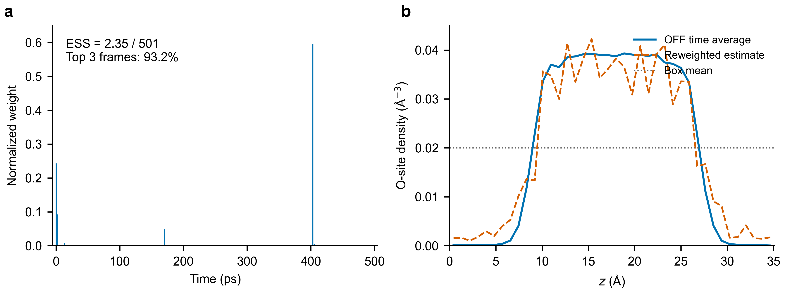
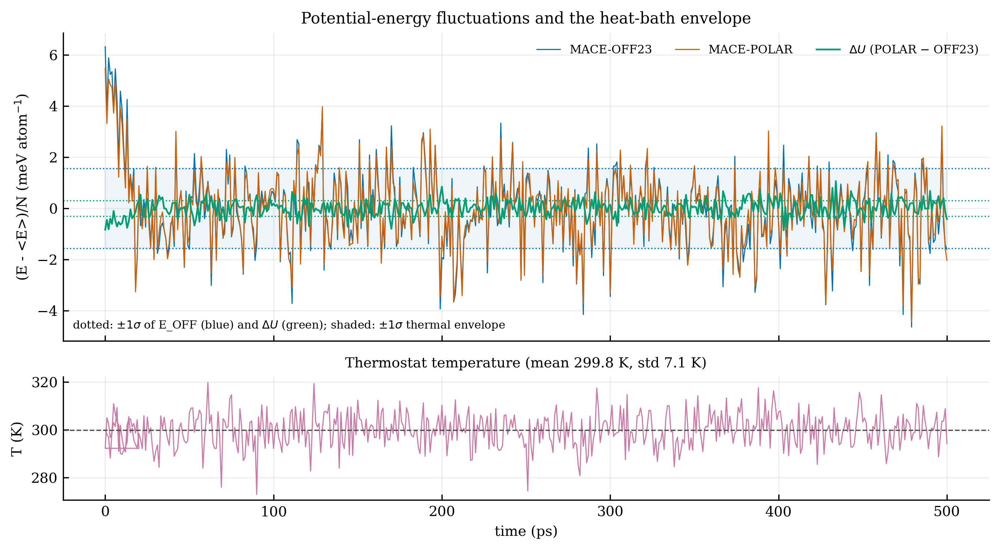

# OFF → POLAR：重加权因子方差与直接关联函数

## 当前 reweighting factor 的方差有多大？

**对上传的501帧能量表，重加权因子的经验相对方差是 `212.311856`，相对标准差约 `14.6`（1460%）；Kish ESS为 `2.348674 / 501 = 0.4688%`。** 最大单帧占总权重的59.60%，前三帧合计93.22%。

数据条件：**MACE-OFF23 → MACE-POLAR；300 K；384个水分子 / 1152个原子；500 ps、每1 ps一帧，共501帧。** 以下方差均使用分母 n = 501，不是 n − 1。

### 权重定义与数值

令 ΔU[i] = U_POLAR[i] − U_OFF23[i]，q[i] = exp(−ΔU[i]/(kB × T))，q_mean 为所有 q 的平均值，T 是温度。原始指数因子随能量零点缩放，因此比较时应看**相对方差**：

```text
CV² = mean((q − q_mean)²) / q_mean² = 212.311856
```

| 量 | 明确定义 | 当前结果 |
|---|---|---:|
| **重加权因子的相对方差** | `CV² = v_q / q_mean²` | **212.311856** |
| 均值为1的权重方差 | `R[i] = q[i] / q_mean = n × w[i]`；`v_R = mean((R − 1)²)` | 212.311856 |
| 归一化权重方差 | `w[i] = q[i] / sum(q)`；`v_w = mean((w − 1/n)²)` | 0.000845860599 |
| 指定能量参考后的指数因子方差 | `a[i] = exp(−(ΔU[i] − min(ΔU))/(kB × T))`；`v_a = mean((a − mean(a))²)` | 0.002381360301 |
| **Kish ESS** | `ESS = 1 / sum(w²) = n / (1 + CV²)` | **2.348674（0.4688%）** |
| 最大单帧权重 | `max(w)` | 59.5987% |
| 前三帧合计权重 | 最大的三个 w[i] 之和 | 93.2183% |
| 整盒能量差标准差 | sd(ΔU)，其中 ΔU = U_POLAR − U_OFF23 | 0.355765 eV（13.7616 kBT） |

**不要把 `0.00084586` 解释成“波动很小”：** 这是总和为1的权重 w[i] 的方差，被 n² 缩小了。均值为1的权重满足 `v_R = n² × v_w = 212.31`。统一减去能量常数不改变相对方差或ESS。

### 关键诊断图



**图中展示已有501帧的权重集中度及源轨迹沿z方向的密度不均匀性。** 这是经验诊断；密度图采用O位点统计，不能直接充当质心密度或已认证的体相c₂输入。[高清PDF图](docs/results/20261027_off_polar_audit/ESS_and_density.pdf) · [图和审计数据](docs/results/20261027_off_polar_audit/README.md)

### 新增：质心 A(x) 与 OFF23 的试算（2026-10-28）

[查看质心密度、对关联和协方差诊断](docs/results/com_estimator_trial_20261028/README.md)。改变 A(x) 后，已有能量权重的 ESS 仍为 2.349。501帧可按编号重建水分子质心，氢原子最近氧归属无不一致；质心对统计在 6–8 Å 的均匀参考值分别为 OFF23 1.564、加权结果 1.492，反映现有分层体系不能直接按均匀体相 OZ 反演。绝对 c₁、目标 c₂ 和 POLAR 结果精度尚未得到验证。

### 新增：c₁ 密度估计器对照（2026-10-28）

[直接查看四面板图和数据](docs/results/c1_estimator_pilot_20261028/README.md)：同一501帧下，空间平滑减小了前后半段差异，但可能带来偏差；条件能量差近似在低密度区域出现超出已见帧支持的尖峰。分母用501帧、分子每5帧取一次时，五种抽帧起点的密度积分约为0.7–1163个分子，真实N=384，说明这一批 qA 采样高度敏感。这些是估计器行为比较，**没有独立POLAR参考，不是目标准确率**。

### 这些数值能说明什么？

- **已确认：** 给定能量表的指数权重高度集中；CV²与ESS的代数关系、上述数值均已复算。[原始能量表](validation/off23_500ps_water1152_2026-10-23/frames_501_total_energies.csv) · [完整方差结果JSON](docs/results/reweight_variance_20261027.json) · [复算程序](scripts/report/reweight_variance_20261027.py)
- **未完成：** 实际MD与PyTorch OFF重算能量去常数后的差异标准差约0.030 eV（约1.16 kBT），需核对引擎、精度与输入。不能把低ESS全部归因于物理差异；这些经验数值也不是总体方差或观测量误差条。
- **学生势另行判断：** 1152原子的学生评分来自OFF旧帧，不能称为学生自采样的ESS；此前“学生生产尺寸不可用”结论已撤回。[修订说明](docs/ESS_STUDENT_TO_POLAR_2026-10-27.md)
- **c₁/c₂尚未认证：** 源轨迹分层、分子密度定义、Widom/OZ实现及独立目标参照仍有待验收；也不能把Gaussian模型外推的 10⁴¹ 帧当实际算量。[TODO](docs/TODO_OFF_POLAR_2026-10-27.md)

**[打开完整12页扩展报告PDF：方差推导、实际 A(x) 与估计器讨论](docs/reports/REWEIGHT_ESTIMATOR_EXTENDED_2026-10-28.pdf)** · [七篇原文逐式对照](docs/reports/FORMULA_CROSSCHECK_PRIMARY_PDFS_2026-10-27.md)

扩展报告新增：每帧氧对计数和质心密度的显式定义；分子分母不同采样频率与协方差；分部积分的目标力密度表达式；以及需要目标力和新单点的验证条件。**这些估计器的比较尚未运行。**

本项目研究从参考势轨迹重加权估计目标势的平衡统计，并探索密度、关联结构和c₁/c₂提取；当前以OFF23→POLAR为实例。旧PDF和原始结果保留用于追溯，当前解释以本页及修订报告为准。

**新文献与 TODO：** [查看四篇估计器论文 PDF、DOI 和清单](papers/estimators_20261028/README.md) · [力采样、谱 RDF 和条件重加权待办](docs/TODO_ESTIMATOR_LITERATURE_2026-10-28.md)。

## 文献中的逐帧校正与重加权

| 工作 | 与本项目直接相关的做法 | 必须保留的条件 |
|---|---|---|
| Chehaibou 2019 / Herzog 2022，MLPT与MLMC | 用少量目标单点学习真实ΔU；目标统计仍按正确源分布配权；重叠不足时重新采样 | 不能任意消掉逐帧真实差值；不能把不同电子结构方法一概当小扰动。2019式(18)符号不一致见公式核对 |
| Hilpert & Kresse 2026，MLP→DFT水 | 63水、5000构型；292K的MACE ESS=4200、KbP ESS=720；323K的KbP ESS=70 | 势函数接近同一RPBE-D3目标，不能直接推广到OFF23→POLAR；截尾会引入偏差 |
| Thaler & Zavadlav 2021，DiffTRe | 结构观测量可微重加权训练；熵ESS不足时刷新参考轨迹 | 熵ESS不同于平方权重ESS；必须匹配实际采样源 |
| Shirts & Chodera 2008，MBAR | 合并多个实际采样状态，可估计Ni=0的目标态 | 已采样分布需覆盖目标；补能量评分不会创造缺失构型 |
| Chatterjee & Diaconis 2018 | 带尾部条件的KL样本量尺度 | 不可将501帧标准差代入未经验证的高斯模型后宣称真实需要10^41帧 |

推导、原文页码、数值与限制见[公式核对](docs/reports/FORMULA_CROSSCHECK_PRIMARY_PDFS_2026-10-27.md)。

## 势能波动（501 帧，1,152 原子）



上：MACE-OFF23、MACE-POLAR 的势能涨落与 ΔU；下：恒温器温度。
热库波动 `std(E_OFF)/N = 1.56 meV/atom`，`ΔU` 的 `std = 0.31 meV/atom`，
两者相关性 0.981；整盒 `ΔU/(kB×T)` 的 `σ = 13.76`。完整说明与另外三张图见
[500 ps 数据包](validation/off23_500ps_water1152_2026-10-23/README.md)。

## 外场幅度 × 温度（q 变体）

`q_i(V; T) = exp(-V_ext,i/(kB×T))`；基准 `q_model = exp(-ΔU_OFF-POLAR/(kB×T))`，
`std(ΔU)=0.356 eV`。数据：120 探帧、3 个场种子。

| q（V; T） | std(ΔV) eV | meV/atom | σ@300K | σ@500K | σ@700K | σ@1000K | 与模型差 |
|---|---:|---:|---:|---:|---:|---:|---:|
| site s=0.25（T=300 K） | 0.203 | 0.176 | 7.84 | 4.70 | 3.36 | 2.35 | 0.57 |
| site s=0.50（T=300 K） | 0.405 | 0.352 | 15.67 | 9.40 | 6.72 | 4.70 | 1.14 |
| site s=1.00（T=300 K） | 0.810 | 0.703 | 31.34 | 18.81 | 13.43 | 9.40 | 2.28 |
| uniform 0.10 V/Å（T=300 K） | 0.240 | 0.208 | 9.28 | 5.57 | 3.98 | 2.79 | 0.67 |
| uniform 0.20 V/Å（T=300 K） | 0.480 | 0.417 | 18.57 | 11.14 | 7.96 | 5.57 | 1.35 |
| **模型差** | **0.356** | **0.309** | **13.76** | **8.26** | **5.90** | **4.13** | **1.00** |

同一外场、不同温度的 q（`std(ΔV)` 固定，只有 T 变）：

| q（V; T） | std(ΔV) eV | σ | 与模型差 |
|---|---:|---:|---:|
| site s=0.5, T=300 K | 0.405 | 15.67 | 1.14 |
| site s=0.5, T=500 K | 0.405 | 9.40 | 1.14 |
| site s=0.5, T=700 K | 0.405 | 6.72 | 1.14 |
| site s=0.5, T=1000 K | 0.405 | 4.70 | 1.14 |
| uniform 0.10 V/Å, T=300 K | 0.240 | 9.28 | 0.67 |
| uniform 0.10 V/Å, T=500 K | 0.240 | 5.57 | 0.67 |
| uniform 0.10 V/Å, T=700 K | 0.240 | 3.98 | 0.67 |
| uniform 0.10 V/Å, T=1000 K | 0.240 | 2.79 | 0.67 |
| **模型差, T=300 K** | **0.356** | **13.76** | **1.00** |
| **模型差, T=500 K** | **0.356** | **8.26** | **1.00** |
| **模型差, T=700 K** | **0.356** | **5.90** | **1.00** |
| **模型差, T=1000 K** | **0.356** | **4.13** | **1.00** |

（`std(ΔV)` 沿用 300 K 轨迹的值；严格变温需要对应温度的轨迹重新测分布。）

要点：与模型差同量级的是 site **s≈0.4–0.6** 或均匀场 **E≈0.15 V/Å**；当前采样
`s=1` 的场扰动是模型差的 2.28 倍。同一 eV 幅度的无量纲宽度 ∝ 1/T（T 越高越容易）。
完整 3 seeds × 7 幅度 × 4 温度的表和说明见
[field_amplitude_20261028](docs/results/field_amplitude_20261028/README.md)。

## 方法

对于相同温度、粒子数、体积和约束下的源体系与目标体系，在第i帧完整构型X[i]上计算总势能差，然后计算归一化权重：

```text
ΔU[i] = U_target(X[i]) − U_source(X[i])
q[i]  = exp(−ΔU[i] / (kB × T))
w[i]  = q[i] / sum(q)
```

目标平衡平均与权重集中度估计为：

```text
目标平均值 A_target ≈ sum(w[i] × A(X[i]))
Kish ESS            = 1 / sum(w[i]²)
```

以上sum均对所有帧求和；mean使用分母n。q是未归一化指数因子，w的总和为1。首页采用普通文本公式以保证显示兼容性，正式排版的数学公式见修订PDF。

能量差使用**整帧总能量**。若两体系的外场不同，还需包含外场总能量差；相同外场会抵消。计算指数前减去最大的对数权重可避免溢出，固定粒子数下的全局能量常数也会在归一化时抵消。

ESS 衡量权重集中程度，本身不处理轨迹自相关，也不保证某个观测量准确。判断 c₁/c₂ 是否可用，还需要平衡与分块检查、有限尺寸分析，以及独立目标势的参照。当前程序返回的 `usable`、`marginal`、`collapse` 是启发式诊断标记，不能直接作为训练标签的合格判定。

## c₁/c₂ 的范围

| 量 | 提取方式与当前边界 |
|---|---|
| 密度、RDF、结构因子等平衡统计 | 对构型对应的统计量加权；不能用重加权恢复目标势的真实时间演化 |
| 均相 c₂ | 先加权关联统计，再用适用的 OZ/响应关系提取；当前代码是 O–O RDF 的标量 OZ 路径，不能当作完整位置—取向分子 c₂ |
| 均相绝对 c₁ | 需要目标化学势和一致的分子理想参考；已有 Widom 工具仍需修复与验收 |
| 外场下中心化 c₁ | 可由目标密度和目标外场的 EL 关系提取，化学势常数可消除；完整标签流程尚待集成验收 |

c₁、c₂(r) 为无量纲量，傅里叶 c₂(k) 的单位为 ų。用于 BZA 分子模型时需统一 COM 密度、原子位点密度和取向投影的定义。能量拟合中的 `linear.slope`、`linear.intercept_eV` 与这里的直接关联函数 c₁/c₂ 无关。

## 安装与检查

使用 Python 3.10 或更高版本。从仓库根目录安装基本依赖和测试工具；当前 Widom/审计路径还需要 SciPy：

```bash
python -m pip install -e ".[test]" scipy
python -m pytest tests -q
```

不加载 MACE 模型，也能重放随仓数据的 CPU 检查。输出文件必须使用一个尚不存在的路径：

```bash
python validation/audit_existing_results.py --output runs/audit-check.json
```

该命令复算权重和温度诊断、检查当前 RDF 归一化，并重现尚待修复的 Widom 分母问题。它不会生成合格的 c₁/c₂ 标签，也不会启动新的 MD。

如需调用 MACE 模型，再安装对应依赖，并准备目标模型需要的长程计算模块：

```bash
python -m pip install -e ".[mace,test]" scipy
export GRAPH_LONG_RANGE_PATH=/path/to/graph_electrostatics-0.4.0
```

模型文件及 `graph_longrange` 由使用者提供，仓库不包含模型权重。

## 对已有轨迹进行诊断

输入为 ASE 可读取的 `extxyz` 轨迹，以及源势和目标势的模型路径。需先确认轨迹已经平衡、源能量对应实际采样势，并且分析温度与采样设定一致。瞬时动能温度的平均值不能直接替代采样温度。

```python
from pathlib import Path
import ase.io
from sampling.off_polar import OffPolarReweighter, ReweightConfig

frames = list(ase.io.iread("source_prod.xyz", format="extxyz"))
outdir = Path("runs/my_reweight_trial")
if outdir.exists():
    raise FileExistsError(outdir)

# 示例仅用于固定 N/V 的正交周期盒。
# 球壳 RDF 的采样半径须小于最短盒边的一半。
rmax = min(6.0, 0.49 * float(frames[0].cell.lengths().min()))
config = ReweightConfig(temperature_K=300.0, rdf_rmax_A=rmax)
rw = OffPolarReweighter.from_models(
    source_model="/path/MACE-OFF23_medium.model",
    target_model="/path/MACE-POLAR-1-M.model",
    config=config,
)
result = rw.evaluate(frames)
result.write(outdir)
print("weight ESS:", result.ess, "sigma_beta:", result.sigma_beta)
```

`evaluate()` 会对选取的每帧计算目标能量和力。帧中已有 `OFF_energy` 时，程序优先使用它作为源能量；因此不能混用其他势、其他精度或不同参考定义的能量字段。当前代码尚未自动完成所有输入审核，需结合[检查记录](docs/AUDIT_2026-10-23.md)使用。

| 输出 | 内容 |
|---|---|
| `reweight_manifest.json` | 温度、能量差、权重、ESS、线性拟合和模型来源等诊断信息；部分历史文件缺少完整模型哈希 |
| `reweight_frames.csv` | 逐帧能量差、归一化权重和力差 |
| `reweight_diagnostics.png` | 权重与结构统计的诊断图 |

轨迹生成与命令行接口位于 `scripts/` 和 `sampling/cli.py`。当前重加权 CLI 使用默认的 8 Å RDF 半径；小盒子应使用上面的 Python 接口显式设置半径，几何范围的自动校验列在待完成计划中。

## 已有结果与后续工作

| 项目 | 当前状态 |
|---|---|
| Boltzmann 权重、常数偏移不变性及 ESS | 已有测试和现有能量数据的独立复算 |
| RDF 球壳体积归一化 | 已修复；新增理想气体与配位数测试 |
| 96 原子短轨迹重加权 | 36 帧按 334 K 分析时 ESS=3.63；按 300 K 作敏感性复算为3.34。仅为诊断案例，不能据此认证 c₁/c₂ |
| 1152 原子早期检查 | 六个预热帧的 ESS≈1；尚不能据此判定充分平衡后的长轨迹。仓库另有500 ps运行记录，其完成情况以对应结果为准 |
| Widom 与分子理想参考 | 分母错误已复现；加权插入与刚性/柔性参考约定待完成 |
| OZ 网格、有限尺寸与误差 | 网格和真实轨迹流程仍待修正/验收；解析测试通过不能替代这些检查 |
| 目标 POLAR c₁/c₂ 标签 | 尚未完成独立目标参照、观测量不确定度和完整资格审核 |
| 重加权因子方差推导（修订） | OFF旧帧的经验CV²=212.311856、Kish ESS=2.348674；不是总体散度测量。见[扩展PDF](docs/reports/REWEIGHT_ESTIMATOR_EXTENDED_2026-10-28.pdf)；旧PDF保留为历史版本 |
| 学生势评分（修订） | 1152原子来自OFF旧帧，撤回学生生产尺寸不可用结论；96原子仅19帧，验证集未认证为平衡样本。见[报告](docs/ESS_STUDENT_TO_POLAR_2026-10-27.md) |

后续顺序是：先修实现与输入约定，再重算已有数据，然后用匹配的 OFF/POLAR 采样验证。若直接重加权仍无法满足观测量精度要求，再实际采样中间混合势或更接近 POLAR 的参考势。在当前覆盖不足的情况下，需要实际的桥接或改进源势采样；MBAR一般允许未直接采样的目标态，但给同一批旧帧增加能量评分不能补出缺失构型。

## 文档与目录

| 入口 | 内容 |
|---|---|
| [检查记录](docs/AUDIT_2026-10-23.md) | 已复现的问题、证据、适用范围与检查状态 |
| [修复与验证计划](docs/superpowers/plans/2026-10-23-polar-c1c2-validation.md) | 优先级、具体文件、回归测试及采样验收步骤 |
| [实验记录](docs/EXPERIMENTS.md) | 历史数值、RDF修正和采样记录 |
| [PDF阅读入口](docs/reports/README.md) | 理论与实验报告；部分后续审计事项尚未反映到PDF中 |
| [c₁/c₂定义](docs/DIRECT_CORRELATION.md) | 物理定义与现有提取路径，阅读时结合页首审计说明 |
| `sampling/` | 重加权、轨迹、直接关联函数和CLI实现 |
| `tests/` | 数学与实现检查；当前14项测试不等于生产数据资格审核 |
| `validation/` | 反例、解析参照、复算脚本和小型结果 |
| `examples/water96/` | 随仓96原子短轨迹示例及历史诊断 |

理论推导与参考文献见 [docs/THEORY.md](docs/THEORY.md)，其中待修订的覆盖率/ESS解释已在页首标注。大型原始轨迹、模型权重、大型计算输出和软件环境不作为本仓交付内容；随仓短轨迹用于方法检查。
