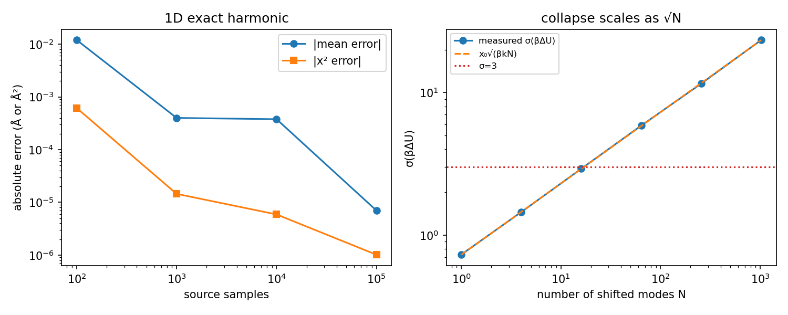

# Theoretical validation

Run:

```bash
python validation/harmonic.py
pytest -q
```

## 1D exact harmonic

Source \(p_A=\mathcal N(0,1/(\beta k))\), target
\(p_B=\mathcal N(x_0,1/(\beta k))\).  The exact target moments are
\(\langle x\rangle_B=x_0\), \(\langle x^2\rangle_B=x_0^2+1/(\beta k)\).
The reweighted estimates converge as the number of source samples grows:

| samples | reweighted ⟨x⟩ (Å) | error (Å) | reweighted ⟨x²⟩ (Ų) | error (Ų) |
|---:|---:|---:|---:|---:|
| 100 | 0.00799 | −0.01201 | 0.000538 | −0.000616 |
| 1,000 | 0.02040 | +0.00040 | 0.001168 | +0.0000145 |
| 10,000 | 0.02038 | +0.00038 | 0.001159 | +0.0000059 |
| 100,000 | 0.02001 | +0.0000070 | 0.001152 | −0.0000010 |

## N-mode collapse

For \(N\) independent modes each shifted by \(x_0\),

\[
\sigma_\beta = x_0\sqrt{\beta k N}.
\]

The measured values reproduce the analytic line and ESS collapses:

| N modes | measured σ_β | theory x₀√(βkN) | ESS / frames |
|---:|---:|---:|---:|
| 1 | 0.731 | 0.729 | 58.9 % |
| 4 | 1.453 | 1.458 | 12.3 % |
| 16 | 2.923 | 2.915 | 1.02 % |
| 64 | 5.867 | 5.830 | 0.19 % |
| 256 | 11.552 | 11.661 | 0.031 % |
| 1,024 | 23.366 | 23.322 | 0.025 % |

This is the numerical version of the paper's \(\sqrt N\) argument: direct
reweighting is intrinsically size-limited, even when the per-mode error is
only 0.02 Å.



## Unit tests

`tests/` checks the normalized weights, ESS bounds, the linear slope recovery
for an exactly linear target, the collapse verdict, observable reweighting,
the OZ inversion, and the RDF normalization.  These tests do not load MACE;
they validate the estimator algebra.  14 tests pass.

## Direct correlation c2 (Ornstein–Zernike)

`validation/direct_correlation.py` and the OZ tests validate the inversion
against analytic data:

| Test | Result |
|---|---|
| Smooth analytic \(c(r)=-5e^{-r^2/2\sigma^2}\), \(\rho=0.2\) | max abs error **4.9e-13** |
| Percus–Yevick hard spheres, \(\eta=0.4\), \(0.2<r<0.9\) | max abs error **2.1e-13** |
| Ideal gas \(g=1\) | c2 = 0 exactly |
| RDF ideal gas | \(\langle g\rangle=1\) within 5% |
| RDF coordination | \(4\pi\rho\int r^2g\,dr\) matches raw pair count within 5% |
| PY at \(r=0\) | Gibbs ringing from the discontinuous c(r); not used as a pass criterion |

The reconstruction is therefore correct for smooth c2; the hard-sphere core
needs a discontinuity-aware transform, not a finer grid alone.

### Energy offset between force fields

The MACE-OFF/MACE-POLAR total energies differ by a large constant
(416.6 meV/atom in the 96-atom probe).  This offset:

- is removed before exponentiating in reweighting; it cancels in normalized
  weights;
- **does not affect c2**, which is derived from g(r) and is invariant under a
  constant energy shift;
- shifts c1 by \(-\beta\Delta E\) (about \(-16.1\) for 416.6 meV/atom at 300 K),
  so absolute c1 values must be aligned before comparing two force fields.

This is why the PRL uses c2 matching from bulk g(r): it is insensitive to the
energy zero and needs no inhomogeneous profiles.
