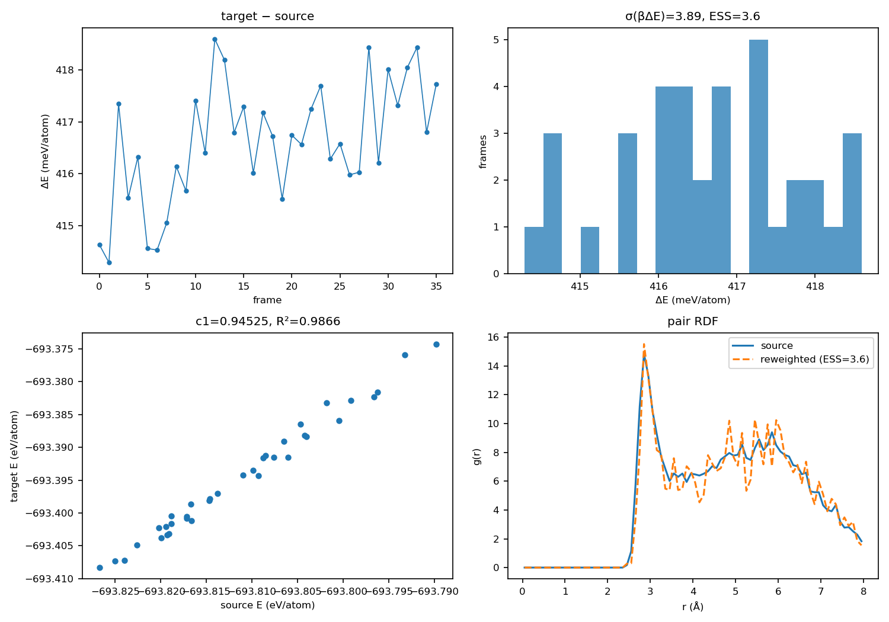

# Feasibility run: 96-atom water, MACE-OFF → MACE-POLAR

This is the end-to-end feasibility probe shipped with the interface.  It is
**not** a production 1 ns run.

## Setup

- Structure: one physical liquid-water frame from the Symmetrix-Polar bulk
  pilot, 96 atoms (32 H\(_2\)O), 11.696 Šbox, density 0.02 molecules/ų,
  300 K.  (Do not use `water_1296.data` from the speed tests: it has a
  0.22 Å contact and produces ~6.8e6 eV/Å MACE-OFF forces.)
- Source: MACE-OFF23 medium, NVT Langevin, 5 ps total, 0.5 ps discarded,
  frames every 0.1 ps.  The first 10 frames were discarded from the analysis,
  leaving **36 production frames**.  Thermostat setpoint 300 K; the mean
  instantaneous temperature after 1 ps was **334 K** (weak friction 0.01;
  production should use stronger coupling and a longer equilibration).
- Target: MACE-POLAR-1-M, FP64, PyTorch calculator.

Commands:

```bash
export GRAPH_LONG_RANGE_PATH=/path/to/graph_electrostatics-0.4.0
off-polar-run --structure water96.xyz \
  --model MACE-OFF23_medium.model --out off_traj.xyz \
  --temperature 300 --ps 5 --equil-ps 0.5 --frame-ps 0.1
off-polar-reweight --traj off_traj_prod.xyz \
  --polar-model MACE-POLAR-1-M.model --temperature 334 --outdir reweight
```

## Results

| Quantity | Value |
|---|---:|
| frames × atoms | 36 × 96 |
| ΔE/atom mean (constant offset) | **416.62 meV/atom** |
| ΔE/atom std | **1.166 meV/atom** |
| \(\sigma_\beta=\mathrm{std}(\beta\Delta E)\) | **3.89** |
| ESS | **3.63 / 36 = 10.1 %** |
| verdict | **marginal** |
| linear slope | 0.9452 |
| linear intercept (total) | −3,606.84 eV |
| \(R^2\) | 0.9866 |
| residual RMS | 1.03 meV/atom |
| force MAE (source vs target) | 104.7 meV/Å |



## Interpretation

- The constant offset (416.6 meV/atom) is **irrelevant** after normalization;
  the intercept cancels exactly.
- The fluctuation is what matters: 1.166 meV/atom at 96 atoms already gives
  \(\sigma_\beta=3.89\) and only ~4 effective frames.
- The linear fit has a high \(R^2=0.987\), but its residual is 1.03 meV/atom,
  i.e. almost as large as the total fluctuation.  A global slope correction
  therefore does **not** rescue the reweighting; the residual must stay in the
  weight.
- Assuming independent local fluctuations, \(\sigma_\beta\propto\sqrt N\):
  - 1,296 atoms: \(3.89\sqrt{13.5}=14.3\)
  - 5,184 atoms: \(3.89\sqrt{54}=28.6\)

  Both are far above the \(\sigma_\beta\lesssim3\) reliability threshold, so
  direct reweighting at the production sizes is expected to collapse to
  ESS ≈ 1 frame.
- The force MAE (105 meV/Å) confirms that the two potentials are not close
  enough for a stable exponential average on this state point.

## Direct correlation functions (PRL c1/c2)

`c2(r)` was extracted from this trajectory with the Ornstein–Zernike
inversion (`off-polar-c2`, output in `c2/`).  The 96-atom/5 ps RDF is **too
noisy for a quantitative c2**: the plotted values swing between −47 and +117
because the low-k limit and the finite box dominate.  Use 5–10 ns and a box
with \(L\gtrsim2r_{\rm cut}\) before interpreting c2.  c1 is a constant for
a homogeneous fluid and requires Widom insertion or a functional derivative;
the utility `c1_from_widom` is provided but was not run on this dense probe.

These PRL c1/c2 are **not** the linear `slope/intercept` in the reweighting
manifest.  See [`docs/DIRECT_CORRELATION.md`](../../docs/DIRECT_CORRELATION.md).

## What to do instead

1. Use the **mean-energy-gap / Gaussian approximation** only for a
   free-energy profile along a collective variable, not for arbitrary
   ensemble averages.
2. Use **BAR/MBAR** if several overlapping intermediate potentials are
   available.
3. For production statistics, run short **MACE-POLAR** trajectories or a
   distilled target model; use MACE-OFF only as a qualitative source.
4. If a small system is sufficient, the 96-atom case is a useful boundary:
   direct reweighting is marginal there and fails at 1,296+ atoms.

The exact weight formula and references are in
[`docs/THEORY.md`](../../docs/THEORY.md); the analytic \(\sqrt N\) validation is
in [`docs/VALIDATION.md`](../../docs/VALIDATION.md).
